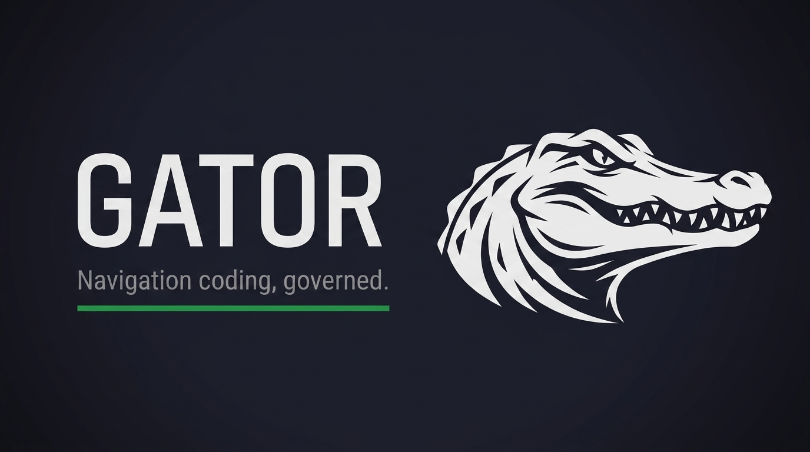

<!-- ASCII fallback:
  ....    .  .....  ...  ....
 / ___|  / \|_   _|/ _ \|  _ \    ....
| |  _  / _ \ | | | | | | |_) | ./( o )\_______
| |_/ \/ /_\ \| | | |_| |  _ <       _/vVvVvVvV
 \____/m/   \m\_|  \___/|m| \m\  \__.---------
-->



[](https://pypi.org/project/gator-command/) [](https://pypi.org/project/gator-command/) [](https://github.com/cumberland-laboratories/gator/blob/main/LICENSE) [](https://pypi.org/project/gator-command/)

  

Most AI coding tools generate code from local context. Gator is different: it makes models build *and maintain* a compact map of your codebase as they work, so architectural understanding survives across sessions instead of being rediscovered each time.

Further, Gator guides models in maintaining a human-readable project knowledge base for roadmaps, features, issues, and design decisions, enabling long-horizon collaboration between you and one or more AI coding agents.

Local-first. Git-native. Works with Claude Code, Codex, Gemini CLI. Apache 2.0 licensed.

## Installation Notes

Gator adds a `.gator/` folder to your repo — this is the governance and intelligence layer. It contains the constitution, charters, and policy that govern AI-assisted development. The enforcement runtime itself executes from the installed CLI on each machine (2.9+): the repo commits a `runtime-pin.json` recording the minimum runtime version it requires, git's own `repositoryformatversion` pattern.

**What it does:**
- Creates `.gator/` with governance scaffolding (constitution, templates, runtime pin) and `GATOR_INIT.md`, Gator's entry document. A session starts when you run `gator init`; its output names `GATOR_INIT.md` and the files to read next
- Installs four Gator slash commands into your vendor `commands/` directory (`.claude/commands/init.md`, `update.md`, `commit.md`, `loop-join.md`; parallel for `.codex/` and `.gemini/`). Any existing non-Gator command file at the same name is backed up with a `.pre-gator` suffix before overwrite
- Merges Gator entries into `.claude/settings.json`, `.codex/hooks.json`, `.gemini/settings.json` non-destructively — your permissions, environment variables, and non-Gator hooks are never touched
- Installs git hooks (`pre-commit`, `commit-msg`, `post-commit`) for governance enforcement
- Adds `.gitignore` entries for personal `CLAUDE.local.md` / `AGENTS.local.md` / `GEMINI.local.md` files, so per-machine notes stay out of Git

**What it does not do:**
- Does not modify your source code
- Does not create, edit, back up, or repair `CLAUDE.md`, `AGENTS.md`, or `GEMINI.md`. These files belong to your repository. They are optional; you can add a one-line pointer to `gator init` if you want your AI tool to start Gator automatically
- Does not overwrite user-authored slash commands (only the four Gator-owned ones are refreshed on update)
- Does not connect to any outside API or platform
- Does not send data anywhere — Gator is entirely markdown and Python files in Git

## Installing Gator

If you don't have pipx yet:

```
pip install pipx
```

```
pipx ensurepath
```

Restart your terminal, then:

```
pipx install gator-command
```

```
gator dashboard
```

That's it. Gator is now live.

## License

Apache 2.0 — [Cumberland Laboratories](https://github.com/cumberland-laboratories)

[PyPI](https://pypi.org/project/gator-command/) · [Source](https://github.com/cumberland-laboratories/gator) · [Changelog](CHANGELOG.md)
